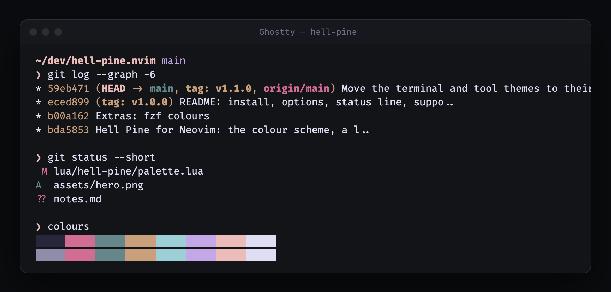

# Hell Pine for Ghostty

A darker, higher-contrast take on Rosé Pine, born inside tmux, for Ghostty.



Real terminal output, drawn with the colours in this theme file.

## Install

```sh
mkdir -p ~/.config/ghostty/themes
curl -fsSL https://raw.githubusercontent.com/abxengg/hell-pine-ghostty/main/hell-pine -o ~/.config/ghostty/themes/hell-pine
```

Then in `~/.config/ghostty/config`:

```
theme = hell-pine
```

## Palette


## Other ports

Hell Pine comes from the [VS Code theme](https://github.com/abxengg/hell-pine). Every port is made from the one
palette in [hell-pine.nvim](https://github.com/abxengg/hell-pine.nvim) by its `scripts/extras.py`, so the colours stay the
same everywhere: [Neovim](https://github.com/abxengg/hell-pine.nvim),
[WezTerm](https://github.com/abxengg/hell-pine-wezterm), [kitty](https://github.com/abxengg/hell-pine-kitty), [Alacritty](https://github.com/abxengg/hell-pine-alacritty), [tmux](https://github.com/abxengg/hell-pine-tmux), [Starship](https://github.com/abxengg/hell-pine-starship), [btop](https://github.com/abxengg/hell-pine-btop), [fish](https://github.com/abxengg/hell-pine-fish), [Zed](https://github.com/abxengg/hell-pine-zed), [fzf](https://github.com/abxengg/hell-pine-fzf).

To change a colour, edit the palette there and run the script; do not edit `hell-pine` by hand.

## Licence

MIT, see [LICENSE](LICENSE).
